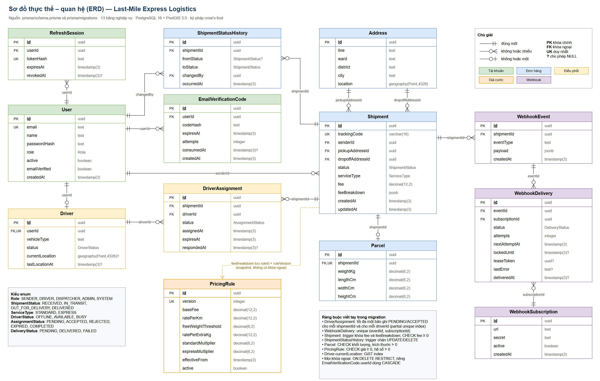
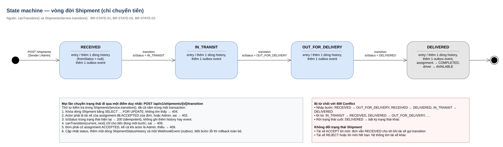

# Mô hình dữ liệu và bảo mật

Phần báo cáo do M3 (Trần Trung Hiếu) phụ trách, mô tả cách hệ thống MoveFlow lưu dữ liệu, giữ cho dữ liệu đúng và bảo vệ API. Các con số trong tài liệu được lấy từ database và code thực tế ngày 03/11/2026.

## 1. Mô hình dữ liệu

Hệ thống dùng PostgreSQL 16 với PostGIS 3.5, truy cập qua Prisma 7. Schema có 13 bảng nghiệp vụ, 6 kiểu enum, 14 khóa ngoại và 17 index ngoài khóa chính.

| Miền      | Bảng                                                      | Vai trò                                                    |
| --------- | --------------------------------------------------------- | ---------------------------------------------------------- |
| Tài khoản | `User`, `RefreshSession`, `EmailVerificationCode`         | Định danh, phiên đăng nhập, xác minh email                 |
| Đơn hàng  | `Shipment`, `Parcel`, `Address`, `ShipmentStatusHistory`  | Đơn giao, kiện hàng, địa chỉ có tọa độ, lịch sử trạng thái |
| Điều phối | `Driver`, `DriverAssignment`                              | Tài xế, vị trí hiện tại, lời mời nhận đơn                  |
| Giá cước  | `PricingRule`                                             | Bảng giá có phiên bản                                      |
| Webhook   | `WebhookSubscription`, `WebhookEvent`, `WebhookDelivery`  | Đăng ký nhận sự kiện, outbox, trạng thái gửi               |

Các quyết định thiết kế chính:

- **Tách `Address` khỏi `Shipment`.** Tọa độ lưu kiểu `geography(Point,4326)`, nên PostGIS tính được khoảng cách theo mét và tìm tài xế trong bán kính bằng GiST index. Lưu địa chỉ dạng chuỗi trong `Shipment` sẽ mất khả năng này.
- **Tiền dùng `decimal(12,2)`**, không dùng số thực, để tránh sai số làm tròn.
- **Phí được chụp lại khi tạo đơn.** `Shipment.fee` và `feeBreakdown` lưu phiên bản giá đã dùng. Đổi bảng giá chỉ tạo phiên bản mới, không ảnh hưởng đơn cũ (BR-PRICE-02).
- **Webhook dùng mô hình outbox.** Sự kiện được ghi vào database cùng transaction đổi trạng thái, rồi gửi sau. Lỗi mạng khi gửi không làm hỏng trạng thái đơn (BR-WEBHOOK-01).

So với 9 bảng khái niệm trong tài liệu triển khai, schema có thêm 4 bảng: `RefreshSession` để thu hồi phiên, `WebhookSubscription` và `WebhookDelivery` để theo dõi việc gửi cho từng bên nhận, `EmailVerificationCode` cho luồng xác minh email.

### Chuỗi migration

Lịch sử schema gồm 10 migration nhỏ, mỗi file ứng với một miền nghiệp vụ hoặc một quy tắc, thay cho một file nền duy nhất. Quy ước của nhóm: mỗi thay đổi schema là một migration mới, không sửa migration đã push. Lệnh `npm run db:migrate` kiểm tra lịch sử trước khi chạy và dừng lại nếu gặp database từ baseline cũ, thay vì làm hỏng dữ liệu.

Khi rà toàn bộ chuỗi, `prisma migrate diff` chỉ báo khác ở `driver_location_gist`. Đây là index viết tay mà Prisma không biểu diễn được, nên `schema.prisma` khớp với database thật.

## 2. Giữ dữ liệu đúng ở tầng database

Một số quy tắc được đặt ngay trong database để vẫn đúng khi có lỗi ở tầng ứng dụng hoặc khi có request đồng thời.

| Quy tắc                                      | Cơ chế                                                                    | Kiểm chứng                     |
| -------------------------------------------- | ------------------------------------------------------------------------- | ------------------------------ |
| Một đơn có tối đa một assignment đang mở     | Partial unique index `one_active_assignment_per_shipment`                 | Integration, gán đồng thời     |
| Một tài xế có tối đa một assignment đang mở  | Partial unique index `one_active_assignment_per_driver`                   | Integration, gán đồng thời     |
| Phí đã chụp không đổi (BR-PRICE-01)          | Trigger `shipment_fee_immutable`                                          | Integration, cập nhật bị chặn  |
| Lịch sử chỉ được thêm (BR-AUDIT-01)          | Trigger `history_append_only`                                             | Integration, sửa và xóa bị chặn |
| Phí, kích thước, giá hợp lệ                  | CHECK `nonnegative_fee`, `positive_parcel`, `valid_prices`                | `scripts/qa/db-checks.sql`     |
| Mã vận đơn duy nhất (BR-TRACK-02)            | Unique index trên `trackingCode`                                          | Unit, thử lại khi trùng        |
| Không mất dấu dữ liệu nghiệp vụ              | Khóa ngoại `ON DELETE RESTRICT`, riêng `EmailVerificationCode` dùng CASCADE | Integration, xóa người gửi bị chặn |

## 3. Máy trạng thái đơn hàng

Đơn hàng chỉ đi tiến từng bước: `RECEIVED`, `IN_TRANSIT`, `OUT_FOR_DELIVERY`, `DELIVERED`. Quy tắc nằm trong một hàm duy nhất, `canTransition` tại `apps/api/src/modules/shipments/state-machine.ts`, và chỉ có một chỗ trong code cập nhật cột trạng thái (BR-STATE-02).

Mỗi lần chuyển trạng thái chạy trong một transaction với các bước:

1. Khóa dòng đơn hàng bằng `SELECT ... FOR UPDATE` để các request đồng thời xếp hàng.
2. Kiểm tra người gọi là tài xế đã nhận đơn, hoặc Admin.
3. Nếu đơn đã ở trạng thái đích, trả 200 với `idempotent: true` và không ghi gì thêm.
4. Kiểm tra `canTransition`, sai thì trả 409 và nêu rõ bước chuyển bị từ chối.
5. Cập nhật trạng thái, ghi lịch sử kèm người thực hiện, ghi sự kiện webhook.
6. Khi đến `DELIVERED`, đóng assignment và trả tài xế về `AVAILABLE`.

Vì mọi bước ở chung một transaction, lỗi ở bất kỳ đâu sẽ hoàn tác toàn bộ (BR-STATE-03).

| Test  | Tình huống                          | Kết quả mong đợi                                 |
| ----- | ----------------------------------- | ------------------------------------------------ |
| ST-01..03 | Đi đủ ba bước                   | 200, đủ lịch sử và người thực hiện, tài xế được giải phóng |
| ST-04 | `RECEIVED` nhảy thẳng `DELIVERED`   | 409, không thay đổi gì                           |
| ST-05 | Chuyển tiếp từ `DELIVERED`          | 409                                              |
| ST-06 | Gửi lại trạng thái hiện tại         | 200 `idempotent`, không thêm lịch sử             |
| ST-07 | Tài xế khác hoặc chưa nhận đơn      | 403                                              |
| ST-08 | 8 request đồng thời cùng đích       | Đúng 1 request có hiệu lực, 1 dòng lịch sử       |
| BR-STATE-03 | Ghi sự kiện webhook thất bại  | Trạng thái và lịch sử được hoàn tác              |

Tất cả chạy trên PostGIS thật. Khi bỏ `FOR UPDATE` khỏi code, các test đồng thời fail, chứng tỏ test thực sự kiểm tra khóa dòng.

## 4. Xác thực và phân quyền

### Tài khoản và phiên

- **Mật khẩu:** bcrypt cost 12, dài 10 đến 72 byte UTF-8, không lưu bản gốc.
- **Access token:** JWT HS256, sống 15 phút, kiểm tra cả `issuer` và `audience`. API không khởi động nếu `JWT_SECRET` ngắn hơn 32 ký tự hoặc còn là giá trị mẫu.
- **Refresh token:** chuỗi ngẫu nhiên 48 byte, sống 7 ngày, chỉ lưu hash SHA-256. Mỗi lần làm mới, token cũ bị thu hồi trong transaction có khóa dòng. Đăng xuất, đổi mật khẩu và khóa tài khoản đều thu hồi phiên.
- **Đăng ký công khai:** chỉ tạo tài khoản `SENDER`. Tài xế và điều phối viên do Admin cấp, vì vậy không ai tự nâng quyền được.
- **Xác minh email:** mã OTP 6 chữ số, chỉ lưu HMAC-SHA256, hết hạn sau 10 phút, tối đa 5 lần thử rồi trả 429, gửi lại cách nhau tối thiểu 60 giây. Endpoint gửi lại trả cùng một câu trả lời cho mọi email để không lộ tài khoản nào tồn tại.
- **Đăng nhập:** tài khoản không tồn tại vẫn tốn thời gian so sánh bcrypt, giảm khả năng dò email qua thời gian phản hồi.

### Hai lớp guard

Mọi request đi qua các guard toàn cục theo thứ tự:

1. `ThrottlerGuard` giới hạn tần suất.
2. `AuthGuard` kiểm tra chữ ký và hạn token, rồi đọc tài khoản từ database. Tài khoản bị khóa, chưa xác minh hoặc là `SYSTEM` sẽ bị từ chối ngay, kể cả khi token còn hạn.
3. `RolesGuard` áp dụng ma trận RBAC bằng vai trò đọc từ database, không tin vai trò ghi trong token.

Quyền trên từng bản ghi được kiểm tra thêm ở tầng service: người gửi chỉ thấy đơn của mình, tài xế chỉ thấy đơn được giao.

| Endpoint                                            | Vai trò được phép                                      |
| --------------------------------------------------- | ------------------------------------------------------ |
| `auth/*`, `tracking/:code`, `health`                | Công khai                                              |
| `users/me`, `users/me/password`                     | Mọi vai trò đã đăng nhập                               |
| `POST pricing/quote`, `POST shipments`              | SENDER, ADMIN                                          |
| `GET shipments`                                     | SENDER (của mình), DISPATCHER, ADMIN                   |
| `GET shipments/:id`                                 | SENDER (của mình), DRIVER (được giao), DISPATCHER, ADMIN |
| `POST shipments/:id/transition`                     | DRIVER (đã nhận đơn), ADMIN                            |
| `POST shipments/:id/assign-driver`, `dispatch/queue` | DISPATCHER, ADMIN                                     |
| `assignments/:id/respond`, `drivers/me/*`           | DRIVER                                                 |
| `admin/pricing-rules`, `webhooks/*`, `admin/users`  | ADMIN                                                  |

Ma trận này được kiểm bằng test cho 21 endpoint, mỗi endpoint với người gọi ẩn danh và cả bốn vai trò.

## 5. Bảo vệ API

| Biện pháp          | Cách áp dụng                                                                                     |
| ------------------ | ------------------------------------------------------------------------------------------------ |
| Giới hạn tần suất  | Theo IP, mỗi phút: đăng ký 4, gửi lại mã 3, xác minh 6, đăng nhập 8, tra cứu công khai 30, còn lại 120 |
| Sau proxy          | `TRUST_PROXY_HOPS=1` để tính theo IP thật của người dùng; cổng API chỉ mở trên loopback nên không giả mạo được `X-Forwarded-For` từ máy khác |
| Đầu vào            | DTO và class-validator ở mọi endpoint; trường lạ bị từ chối                                      |
| SQL injection      | Prisma và tagged template có tham số; không dùng hàm raw SQL dạng unsafe trong mã nguồn          |
| Header và CORS     | Helmet; CORS chỉ cho origin khai báo trong `CORS_ORIGIN`                                         |
| Tra cứu công khai  | Mã 64 bit từ nguồn ngẫu nhiên mật mã; chỉ trả mã, trạng thái, thời gian và thành phố             |
| Lỗi                | Không trả stack trace; lỗi 500 có `requestId` để truy vết                                        |
| Webhook            | Ký HMAC-SHA256 trên nội dung gốc, chỉ gửi tới origin trong danh sách cho phép                    |
| Secret             | Nằm trong `.env` đã bị Git bỏ qua; `.env.example` chỉ chứa giá trị mẫu                           |

Đã quét toàn bộ lịch sử Git theo mẫu khóa Resend, khóa Google và private key: không có secret thật, chỉ có giá trị minh họa trong tài liệu.

## 6. Điểm khác so với tài liệu triển khai

| Nội dung              | Tài liệu triển khai                  | Thực tế và lý do                                                                              |
| --------------------- | ------------------------------------ | --------------------------------------------------------------------------------------------- |
| Đăng ký               | Sender và Driver (11.1)              | Chỉ Sender. Tài xế do Admin cấp để tránh tự đăng ký vai trò nội bộ                            |
| Xác minh email        | Không có                             | Thêm OTP để chặn tài khoản giả mạo email                                                      |
| ST-08                 | Request thứ hai nhận 409             | Mục 7.5 yêu cầu double submit trả 200, nên các request cùng đích trả 200 `idempotent`; vẫn chỉ một request có hiệu lực |
| Cập nhật vị trí tài xế | Ma trận cho Admin quyền F (4.2)     | Mục 11.3 chỉ định nghĩa `drivers/me/location` cho Driver, code theo 11.3                      |
| Tra cứu công khai     | Trả mã, trạng thái, timeline (12.2)  | Trả thêm thành phố lấy và giao; không có thông tin định danh (BR-TRACK-01)                    |

## 7. Giới hạn còn lại

Các điểm sau chưa xử lý trong phạm vi MVP và cần làm trước khi triển khai thật:

- Chưa có đặt lại mật khẩu qua email.
- Refresh token cũ dùng lại chỉ bị từ chối, chưa kích hoạt thu hồi cả chuỗi phiên.
- Sau khi đổi mật khẩu, access token đã phát hành vẫn dùng được tối đa 15 phút.
- Người khác có thể đăng ký trước bằng email của bạn. Tài khoản chưa xác minh đó giữ chỗ email, và chưa có job dọn tài khoản hoặc mã OTP hết hạn.
- Bộ đếm rate limit nằm trong bộ nhớ, chỉ đúng khi chạy một instance API.
- Webhook secret lưu dạng rõ trong database, cần mã hóa khi lên production.
- Compose demo chạy HTTP. Môi trường thật cần HTTPS và không dùng tài khoản seed.
