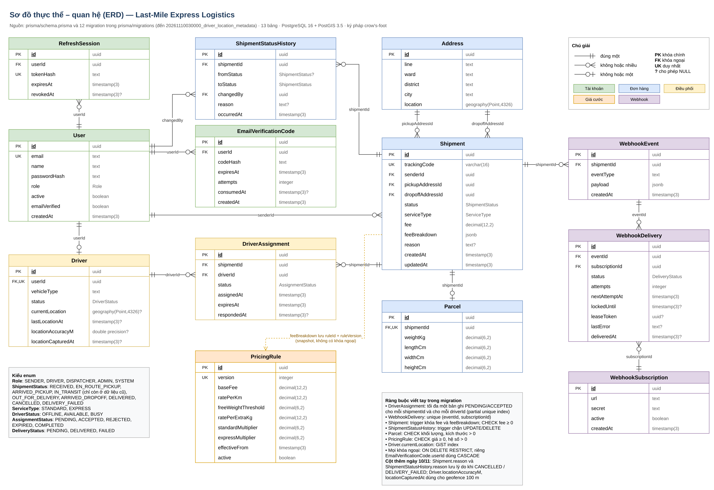
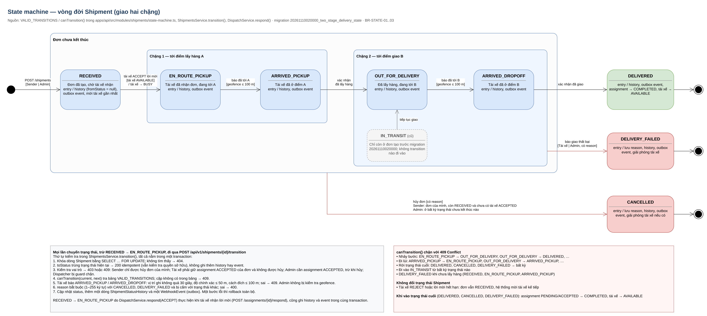

# Mô hình dữ liệu và bảo mật

Phần báo cáo do M3 (Trần Trung Hiếu) phụ trách, mô tả cách hệ thống MoveFlow lưu dữ liệu, giữ cho dữ liệu đúng và bảo vệ API. Các con số được lấy từ database dựng bằng chuỗi migration và từ code sau khi gộp các nhánh M3 lên `main` ngày 17/11/2026.

## 1. Mô hình dữ liệu

Hệ thống dùng PostgreSQL 16 với PostGIS 3.5, truy cập qua Prisma 7. Schema có 13 bảng nghiệp vụ, 6 kiểu enum, 14 khóa ngoại, 17 index ngoài khóa chính, 3 ràng buộc CHECK và 2 trigger.

| Miền      | Bảng                                                      | Vai trò                                                    |
| --------- | --------------------------------------------------------- | ---------------------------------------------------------- |
| Tài khoản | `User`, `RefreshSession`, `EmailVerificationCode`         | Định danh, phiên đăng nhập, xác minh email                 |
| Đơn hàng  | `Shipment`, `Parcel`, `Address`, `ShipmentStatusHistory`  | Đơn giao, kiện hàng, địa chỉ có tọa độ, lịch sử trạng thái |
| Điều phối | `Driver`, `DriverAssignment`                              | Tài xế, vị trí GPS gần nhất, lời mời nhận đơn              |
| Giá cước  | `PricingRule`                                             | Bảng giá có phiên bản                                      |
| Webhook   | `WebhookSubscription`, `WebhookEvent`, `WebhookDelivery`  | Đăng ký nhận sự kiện, outbox, trạng thái gửi               |

Các quyết định thiết kế chính:

- **Tách `Address` khỏi `Shipment`.** Tọa độ lưu kiểu `geography(Point,4326)`, nên PostGIS tính được khoảng cách theo mét và tìm tài xế trong bán kính bằng GiST index.
- **Tiền dùng `decimal(12,2)`**, không dùng số thực, để tránh sai số làm tròn.
- **Phí được chụp lại khi tạo đơn.** `Shipment.fee` và `feeBreakdown` lưu phiên bản giá và quãng đường đã dùng. Đổi bảng giá chỉ tạo phiên bản mới, không ảnh hưởng đơn cũ (BR-PRICE-02).
- **Webhook dùng mô hình outbox.** Sự kiện được ghi vào database cùng transaction đổi trạng thái, rồi gửi sau. Lỗi mạng khi gửi không làm hỏng trạng thái đơn (BR-WEBHOOK-01).
- **Vị trí tài xế kèm độ tin cậy.** `Driver.locationAccuracyM` và `locationCapturedAt` lưu độ chính xác GPS và thời điểm thiết bị ghi, để geofence chỉ dùng vị trí mới và đủ chính xác.
- **Lý do kết thúc sớm.** `Shipment.reason` và `ShipmentStatusHistory.reason` lưu lý do khi đơn bị hủy hoặc giao thất bại.

So với 9 bảng khái niệm trong tài liệu triển khai, schema có thêm 4 bảng: `RefreshSession` để thu hồi phiên, `WebhookSubscription` và `WebhookDelivery` để theo dõi việc gửi cho từng bên nhận, `EmailVerificationCode` cho luồng xác minh email.

### Chuỗi migration

Lịch sử schema gồm 12 migration nhỏ, mỗi file ứng với một miền nghiệp vụ hoặc một quy tắc, thay cho một file nền duy nhất. Quy ước của nhóm: mỗi thay đổi schema là một migration mới, không sửa migration đã push. Lệnh `npm run db:migrate` kiểm tra lịch sử trước khi chạy và dừng lại nếu gặp database từ baseline cũ, thay vì làm hỏng dữ liệu. Kết quả rà migration 10–12 ghi ở [README](README.md).

## 2. Giữ dữ liệu đúng ở tầng database

Một số quy tắc được đặt ngay trong database để vẫn đúng khi có lỗi ở tầng ứng dụng hoặc khi có request đồng thời.

| Quy tắc                                      | Cơ chế                                                                    | Kiểm chứng                                  |
| -------------------------------------------- | ------------------------------------------------------------------------- | ------------------------------------------- |
| Một đơn có tối đa một lời mời đang mở        | Partial unique index `one_active_assignment_per_shipment`                 | Integration, gán đồng thời                  |
| Một tài xế có tối đa một lời mời đang mở     | Partial unique index `one_active_assignment_per_driver`                   | Integration, gán đồng thời                  |
| Phí đã chụp không đổi (BR-PRICE-02)          | Trigger `shipment_fee_immutable`                                          | Integration, cập nhật bị chặn               |
| Lịch sử chỉ được thêm (BR-AUDIT-01)          | Trigger `history_append_only`                                             | Integration, UPDATE và DELETE bị chặn       |
| Phí, kích thước, giá hợp lệ                  | CHECK `nonnegative_fee`, `positive_parcel`, `valid_prices`                | `scripts/qa/db-checks.sql`                  |
| Mã vận đơn duy nhất (BR-TRACK-02)            | Unique index trên `trackingCode`                                          | Unit, thử lại khi trùng                     |
| Không mất dấu dữ liệu nghiệp vụ              | Khóa ngoại `ON DELETE RESTRICT`, riêng `EmailVerificationCode` dùng CASCADE | Integration, xóa người gửi bị chặn          |

## 3. Máy trạng thái đơn hàng

Đơn đi hai chặng: `RECEIVED → EN_ROUTE_PICKUP → ARRIVED_PICKUP → OUT_FOR_DELIVERY → ARRIVED_DROPOFF → DELIVERED`, với hai lối kết thúc sớm là `CANCELLED` và `DELIVERY_FAILED`. Bảng 15 bước chuyển hợp lệ nằm ở một chỗ duy nhất, `VALID_TRANSITIONS` trong `apps/api/src/modules/shipments/state-machine.ts` (BR-STATE-02). Bảng đầy đủ, thứ tự kiểm tra và mã lỗi ở [STATE_MACHINE.md](STATE_MACHINE.md).

Mỗi lần chuyển trạng thái chạy trong một transaction:

1. Khóa dòng đơn hàng bằng `SELECT ... FOR UPDATE` để các request đồng thời xếp hàng.
2. Nếu đơn đã ở trạng thái đích, trả 200 với `idempotent: true` và không ghi gì thêm.
3. Kiểm tra người gọi: tài xế giữ lời mời đã nhận, Sender (chỉ được hủy đơn chưa có tài xế nhận) hoặc Admin.
4. Kiểm tra `canTransition`, sai thì trả 409 và nêu rõ bước chuyển bị từ chối.
5. Tài xế báo đã tới A hoặc B: vị trí phải mới hơn 30 giây, sai số không quá 50 m và cách đích không quá 100 m.
6. Hủy và giao thất bại bắt buộc có lý do.
7. Cập nhật trạng thái, ghi lịch sử kèm người thực hiện, ghi sự kiện webhook; vào trạng thái cuối thì đóng lời mời và trả tài xế về `AVAILABLE`.

Vì mọi bước ở chung một transaction, lỗi ở bất kỳ đâu sẽ hoàn tác toàn bộ (BR-STATE-03). Mười một test case ST-01..ST-11 chạy trên PostGIS thật kiểm tra các quy tắc này, cùng một ma trận đủ 81 cặp trạng thái cho `canTransition`.

## 4. Xác thực và phân quyền

### Tài khoản và phiên

- **Mật khẩu:** bcrypt cost 12, dài 10 đến 72 byte UTF-8, không lưu bản gốc.
- **Access token:** JWT HS256, sống 15 phút, kiểm tra cả `issuer` và `audience`. API không khởi động nếu `JWT_SECRET` ngắn hơn 32 ký tự hoặc còn là giá trị mẫu.
- **Refresh token:** chuỗi ngẫu nhiên 48 byte, sống 7 ngày, chỉ lưu hash SHA-256. Mỗi lần làm mới, token cũ bị thu hồi trong transaction có khóa dòng. Đăng xuất, đổi mật khẩu và khóa tài khoản đều thu hồi phiên.
- **Đăng ký công khai:** chỉ tạo tài khoản `SENDER`. Tài xế và điều phối viên do Admin cấp, vì vậy không ai tự nâng quyền được. Nếu gửi mã OTP cho tài khoản mới thất bại, tài khoản (kể cả hồ sơ tài xế) bị xóa để không để lại tài khoản chết.
- **Xác minh email:** mã OTP 6 chữ số, chỉ lưu HMAC-SHA256, hết hạn sau 10 phút, tối đa 5 lần thử rồi trả 429, gửi lại cách nhau tối thiểu 60 giây. Endpoint gửi lại trả cùng một câu trả lời cho mọi email để không lộ tài khoản nào tồn tại. Mã được gửi qua SMTP bằng App Password của Gmail; chế độ in mã ra log chỉ chạy khi `NODE_ENV` khác `production`.
- **Đăng nhập:** tài khoản không tồn tại vẫn tốn thời gian so sánh bcrypt, giảm khả năng dò email qua thời gian phản hồi.

### Hai lớp guard

Mọi request đi qua các guard toàn cục theo thứ tự:

1. `ThrottlerGuard` giới hạn tần suất.
2. `AuthGuard` kiểm tra chữ ký và hạn token, rồi đọc tài khoản từ database. Tài khoản bị khóa, chưa xác minh hoặc là `SYSTEM` bị từ chối ngay, kể cả khi token còn hạn.
3. `RolesGuard` áp dụng ma trận RBAC bằng vai trò đọc từ database, không tin vai trò ghi trong token.

Quyền trên từng bản ghi được kiểm tra thêm ở tầng service: người gửi chỉ thấy đơn của mình, tài xế chỉ thấy đơn mình được mời.

| Endpoint                                                        | Vai trò được phép                                         |
| --------------------------------------------------------------- | --------------------------------------------------------- |
| `auth/*`, `tracking/:code`, `health`                            | Công khai                                                 |
| `users/me`, `users/me/password`, `geocoding/*`                  | Mọi vai trò đã đăng nhập                                  |
| `POST pricing/quote`, `POST shipments`                          | SENDER, ADMIN                                             |
| `GET shipments`                                                 | SENDER (của mình), DISPATCHER, ADMIN                      |
| `GET shipments/:id`, `GET shipments/:id/live`                   | SENDER (của mình), DRIVER (được mời), DISPATCHER, ADMIN   |
| `GET shipments/:id/navigation`                                  | SENDER (của mình), DRIVER (đã nhận), ADMIN                |
| `POST shipments/:id/transition`                                 | DRIVER (đã nhận), SENDER (chỉ hủy), ADMIN                 |
| `POST shipments/:id/assign-driver`, `dispatch/queue`, `dispatch/drivers` | DISPATCHER, ADMIN                                |
| `assignments/:id/respond`, `drivers/me/*`                       | DRIVER                                                    |
| `admin/pricing-rules`, `webhooks/*`, `admin/users`              | ADMIN                                                     |

Ma trận này được kiểm bằng test cho 27 endpoint cần đăng nhập, mỗi endpoint với người gọi ẩn danh và cả bốn vai trò.

## 5. Bảo vệ API

| Biện pháp          | Cách áp dụng                                                                                     |
| ------------------ | ------------------------------------------------------------------------------------------------ |
| Giới hạn tần suất  | Theo IP, mỗi phút: đăng ký 4, gửi lại mã 3, xác minh 6, đăng nhập 8, tra cứu công khai 30, còn lại 120 |
| Sau proxy          | `TRUST_PROXY=1` trong `compose.yaml` để tính theo IP thật của người dùng; cổng API chỉ mở trên loopback nên không giả mạo được `X-Forwarded-For` từ máy khác. Giá trị `TRUST_PROXY` sai làm API dừng ngay khi khởi động |
| Đầu vào            | DTO và class-validator ở mọi endpoint; trường lạ bị từ chối                                      |
| SQL injection      | Prisma và tagged template có tham số; không dùng hàm raw SQL dạng unsafe trong mã nguồn          |
| Header và CORS     | Helmet ở API; CSP, `X-Frame-Options`, `nosniff` ở nginx; CORS chỉ cho origin khai báo trong `CORS_ORIGIN` |
| Vị trí GPS         | Từ chối tọa độ sai, sai số trên 200 m, mốc thời gian lệch hoặc quá cũ, tốc độ suy ra trên 55 m/s |
| Tra cứu công khai  | Mã 64 bit từ nguồn ngẫu nhiên mật mã; chỉ trả mã, trạng thái, thời gian và thành phố             |
| Lỗi                | Không trả stack trace; lỗi 500 có `requestId` để truy vết                                        |
| Webhook            | Ký HMAC-SHA256 trên nội dung gốc, chỉ gửi tới origin trong danh sách cho phép, không theo redirect |
| Secret             | `JWT_SECRET`, `OTP_SECRET`, App Password SMTP nằm trong `.env` đã bị Git bỏ qua; `.env.example` chỉ chứa giá trị mẫu |

## 6. Điểm khác so với tài liệu triển khai

| Nội dung              | Tài liệu triển khai                  | Thực tế và lý do                                                                              |
| --------------------- | ------------------------------------ | --------------------------------------------------------------------------------------------- |
| Máy trạng thái        | 4 trạng thái, chỉ đi tiến (7.1–7.2)  | 9 trạng thái giao hai chặng, có hủy và giao thất bại; thêm ngày 10/11 cùng tính năng bản đồ   |
| Đăng ký               | Sender và Driver (11.1)              | Chỉ Sender. Tài xế do Admin cấp để tránh tự đăng ký vai trò nội bộ                            |
| Xác minh email        | Không có                             | Thêm OTP để chặn tài khoản giả mạo email                                                      |
| ST-08                 | Request thứ hai nhận 409             | Mục 7.5 yêu cầu double submit trả 200, nên các request cùng đích trả 200 `idempotent`; vẫn chỉ một request có hiệu lực |
| Cập nhật vị trí tài xế | Ma trận cho Admin quyền F (4.2)     | Mục 11.3 chỉ định nghĩa `drivers/me/location` cho Driver, code theo 11.3                      |
| Tra cứu công khai     | Trả mã, trạng thái, timeline (12.2)  | Trả thêm thành phố lấy và giao; không có thông tin định danh (BR-TRACK-01)                    |

## 7. Giới hạn còn lại

Các điểm sau chưa xử lý trong phạm vi MVP và cần làm trước khi triển khai thật:

- Chưa có đặt lại mật khẩu qua email.
- Refresh token cũ dùng lại chỉ bị từ chối, chưa kích hoạt thu hồi cả chuỗi phiên.
- Sau khi đổi mật khẩu, access token đã phát hành vẫn dùng được tối đa 15 phút.
- Người khác có thể đăng ký trước bằng email của bạn. Tài khoản chưa xác minh đó giữ chỗ email, và chưa có job dọn tài khoản hoặc mã OTP hết hạn.
- Bộ đếm rate limit nằm trong bộ nhớ, chỉ đúng khi chạy một instance API.
- Webhook secret lưu dạng rõ trong database, cần mã hóa khi lên production.
- Admin đổi trạng thái không bị kiểm tra geofence (chủ ý, để xử lý sự cố); bước nhận lời mời đổi trạng thái mà không gọi `canTransition()`.
- Compose demo chạy HTTP. Môi trường thật cần HTTPS và không dùng tài khoản seed.
